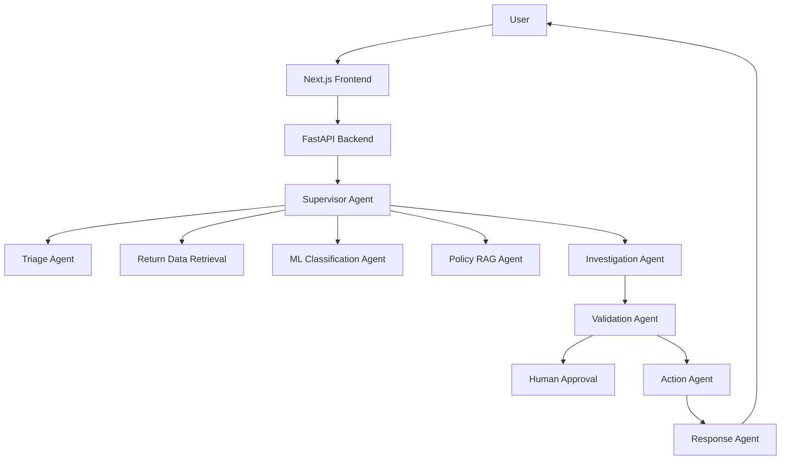
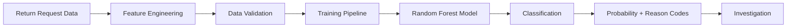
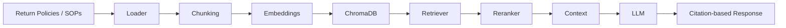

# Retail Return Eligibility Exception Classification Project

## Project Overview
This project builds a production-style retail return investigation and routing system that combines machine learning, generative AI, agentic orchestration, retrieval-augmented generation, policy guardrails, and human review workflows. The system classifies returns into four routing outcomes: Standard Return, Policy Exception, Fraud Review, and Specialist Assessment.

## Business Problem
Retail operations need a reliable and explainable way to evaluate return requests. The application ingests return, customer, product, order, and policy facts to recommend the correct route while ensuring grounded evidence, policy compliance, and review escalation when required.

## Features
- Multi-agent orchestration with specialized roles
- ML-based return routing with probability bands and reason codes
- Policy RAG using Chroma-backed retrieval with citations
- Human approval flow for policy exceptions, fraud, and specialist assessment
- FastAPI backend with typed schemas and structured logging
- Next.js frontend dashboard for workflow monitoring
- Synthetic sample data and policy knowledge base
- Docker and local deployment support

## Architecture


## Multi-Agent Architecture
- Supervisor Agent: routes tasks and governs workflow
- Triage Agent: extracts return metadata and intent
- Return Data Retrieval Agent: fetches customer, order, and product evidence
- ML Classification Agent: classifies routing using a trained model
- Policy RAG Agent: searches policy and SOP content with citations
- Investigation Agent: combines evidence and checks human review triggers
- Action Agent: performs approved actions only
- Validation Agent: checks groundedness and risk thresholds
- Response Agent: produces a final grounded response

## Technology Stack
- Python
- FastAPI
- Pydantic
- LangGraph
- ChromaDB
- Scikit-learn
- OpenAI API-compatible LLMs
- PostgreSQL-ready schema and SQLite fallback
- Redis for session state
- Next.js + TypeScript + Tailwind CSS
- Docker

## ML Classification Architecture


## RAG Architecture


## Workflow
The system starts with triage, retrieves customer and order data, runs a machine learning classification, checks policy documents, investigates the evidence, validates the result, and if required triggers human approval before taking consequential actions.

## Folder Structure
- backend/app/agents
- backend/app/graph
- backend/app/rag
- backend/app/tools
- backend/app/models
- backend/app/ml
- backend/app/services
- backend/app/prompts
- backend/knowledge_base
- backend/data
- frontend/app
- docker-compose.yml
- Dockerfile
- .env.example

## Installation
```bash
python -m venv .venv
source .venv/bin/activate
pip install -r requirements.txt
```

## Environment Variables
Copy the sample file and update values as needed:

```bash
cp .env.example .env
```
Required variables:
- OPENAI_API_KEY
- OPENAI_MODEL
- APP_ENV
- DATABASE_URL
- REDIS_URL
- CHROMA_PERSIST_DIRECTORY
- NEXT_PUBLIC_API_URL

## Running Locally
Start the backend:

```bash
uvicorn backend.app.main:app --host 0.0.0.0 --port 8000 --reload
```

Start the frontend:

```bash
cd frontend
npm install
npm run dev
```

## API Documentation
FastAPI exposes OpenAPI documentation at:
- http://localhost:8000/docs
- http://localhost:8000/redoc

## Sample Requests
```bash
curl -X POST http://localhost:8000/api/returns/classify \
  -H 'Content-Type: application/json' \
  -d '{
    "return_id": "RET-102",
    "customer_id": "CUS-016",
    "order_id": "ORD-889",
    "product_id": "PRD-1234",
    "return_reason": "damaged",
    "product_category": "electronics",
    "order_value": 459.99,
    "return_window_days": 12,
    "delivery_issue": true,
    "damaged_product": true,
    "fraudulent_activity": false,
    "previous_returns": 2,
    "previous_approved_returns": 1,
    "previous_rejected_returns": 1,
    "account_risk_score": 18
  }'
```

## Testing
```bash
PYTHONPATH=/workspaces/ResumeProject2/backend pytest backend/app/tests/test_api.py -q
```

## Docker
```bash
docker-compose up --build
```

## Deployment
The application is structured for Vercel frontend deployment and Docker-based backend deployment. The frontend should be configured with NEXT_PUBLIC_API_URL pointing to the backend service.

## Limitations
- Synthetic demo data instead of production enterprise datasets
- LLM integration is configurable and can be disabled without an API key
- Local Chroma deployment is used for demonstration rather than a fully managed vector store

## Future Enhancements
- Add PostgreSQL tables and ORM-based persistence
- Add real LangSmith/OpenTelemetry traces
- Expand the evaluation dataset and model benchmark suite
- Add reviewer UI and human override flow
- Add stronger retrieval reranking and metadata filtering
